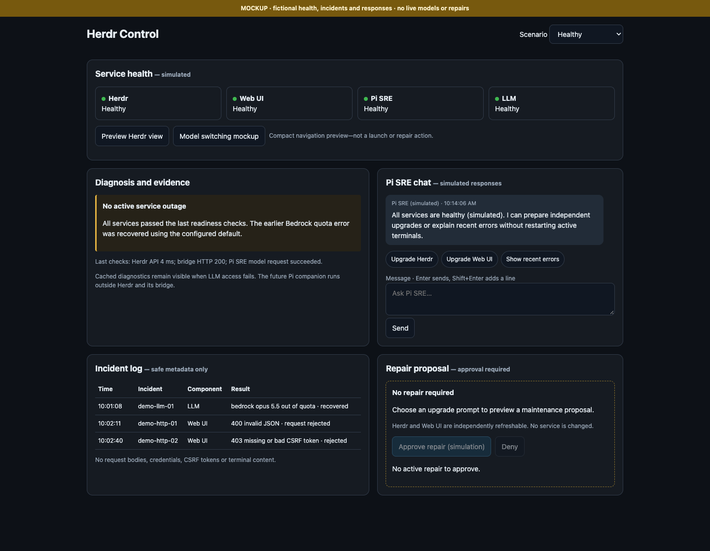
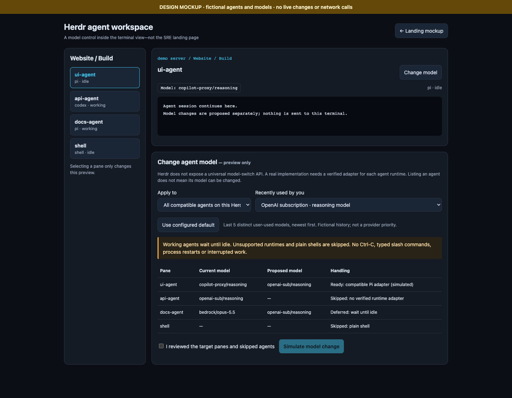

# UI mockups

## Landing page and Pi SRE chat

[Phone preview](sre-landing-phone.png) · [Herdr down](sre-landing-herdr-down.png) ·
[Web UI down](sre-landing-webui-down.png) · [LLM down](sre-landing-llm-down.png)

Open [sre-landing.html](sre-landing.html), or `/mockups/sre-landing` on the running
bridge. This is a clickable **design mockup**, not an operational watchdog.
All hosts, incidents, health states, chat responses and repair proposals are
fictional. Nothing executes terminal commands, calls a model or repairs services.

Try the healthy, Herdr-down, Web-UI-down and LLM-unavailable scenarios. The
landing/status/chat layout illustrates a future independently supervised Pi
companion: losing Herdr must not remove access to its repair agent. Serving this
preview from the current bridge does **not** implement that independent runtime.
Healthy prompts include Upgrade Herdr and Upgrade Web UI. Outage scenarios show
their own root cause, critical incidents and matching approval proposal. LLM
recovery offers Reset to default and the last five distinct user-used models
sorted by usage timestamp; sample history is fictional, not a provider priority.
Changing scenarios or repair targets clears any prior approval. These controls
remain simulations and do not call a model.

The terminal UI at `/` is not replaced by this landing preview.

The chat accepts local demonstration input only; a repair approval, if shown,
is illustrative and never performs a repair. No conversation is sent anywhere.
Do not enter secrets into mockups or commit screenshots containing real data.

Verify with `python3 -m unittest test_mockup -v` using the already installed
Playwright Python package and Chrome. No packages are installed by the tests.

## Agent model switching in the Herdr view

[Phone model selector](model-switch-phone.png)

Open [model-switch.html](model-switch.html), or `/mockups/model-switch` on the
running bridge. This separate fictional terminal-view preview places Change model
beside the current pane's model. Choose the current agent or all compatible agents
on the same Herdr server; inspect the target list and confirm before simulation.
Working agents defer until idle, runtimes without a verified adapter and plain
shells are skipped. No model, process or session is changed.

Herdr has no universal model-switch API. Current model, supported transitions,
provider authorization, and safe timing need runtime-specific implementation and
verification. The mock's compatible Pi adapter and all model history are sample
data, not claims that live switching has been implemented. Its recent choices
use usage timestamps, and Reset to default uses configured defaults—not a fixed
provider order.

## Phone UI proposal

**Design review only. The application and desktop UI are unchanged.**
All session names, code, output, and counts in these mockups are fictional.

Open `phone-ui.html` locally in a browser for the side-by-side board. Follow its
preview links to try the phone-sized prototype, or open these individual images:

- [Focused pane](phone-ui-focus.png): hamburger button, current pane and location,
  Agents button, live terminal, compact input, and key shortcuts. No persistent
  sidebar, tab strip, pane grid, or second inspector panel.
- [Navigation drawer](phone-ui-navigation.png): searchable, expandable
  space → tab → pane tree. Selecting a pane dismisses the drawer. Closing the
  drawer without selecting anything returns to the previous pane.
- [Agents view](phone-ui-agents.png): all agents across spaces, status totals,
  search, and blocked agents first. Selecting an agent opens its pane; closing
  the view returns to the previous pane. Plain shells stay in navigation only.

## Proposed behavior for approval

- Use the existing focused pane on first entry, then keep the browser's selected
  pane while navigating. Selecting a pane must not interrupt agents or change
  the desktop/TUI's focus.
- Show a small attention indicator on the Agents button if any agent is blocked.
- Keep the existing dark visual language. Desktop keeps its current layout.
- The phone terminal scrolls independently; input stays below it. A future
  implementation must accommodate the on-screen keyboard without hiding input.
- Retain the current input modes and full key set; extra keys and less common
  actions can live in secondary controls instead of crowding the terminal.

The prototype demonstrates navigation, selection, and search only. Its terminal
is sample content; send/key buttons never send anything, and it makes no API or
external requests. It is not a functional mobile implementation or proof of
real-device keyboard behavior. Application implementation waits for approval.
