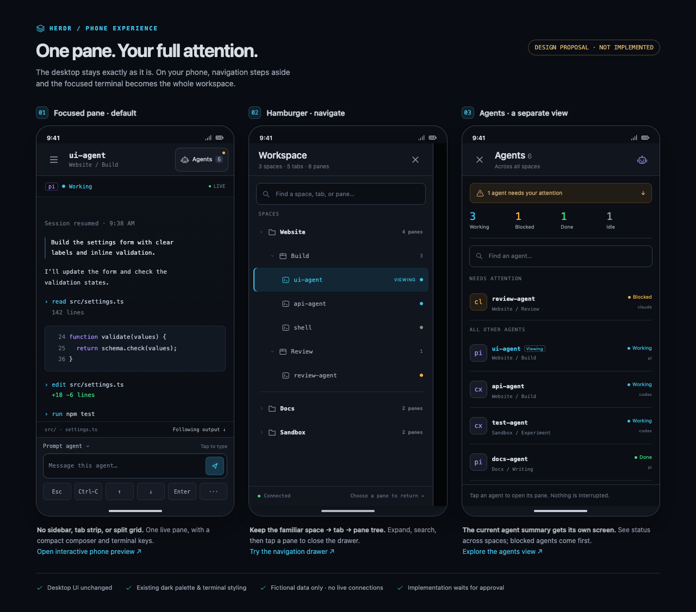

# Phone UI proposal

**Design review only. The application and desktop UI are unchanged.**
All session names, code, output, and counts in these mockups are fictional.

Open `phone-ui.html` locally in a browser for the side-by-side board. Follow its
preview links to try the phone-sized prototype, or open these individual images:

- [Focused pane](phone-ui-focus.png): hamburger button, current pane and location,
  Agents button, live terminal, compact input, and key shortcuts. No persistent
  sidebar, tab strip, pane grid, or second inspector panel.
- [Navigation drawer](phone-ui-navigation.png): searchable, expandable
  space → tab → pane tree. Selecting a pane dismisses the drawer. Closing the
  drawer without selecting anything returns to the previous pane.
- [Agents view](phone-ui-agents.png): all agents across spaces, status totals,
  search, and blocked agents first. Selecting an agent opens its pane; closing
  the view returns to the previous pane. Plain shells stay in navigation only.

## Proposed behavior for approval

- Use the existing focused pane on first entry, then keep the browser's selected
  pane while navigating. Selecting a pane must not interrupt agents or change
  the desktop/TUI's focus.
- Show a small attention indicator on the Agents button if any agent is blocked.
- Keep the existing dark visual language. Desktop keeps its current layout.
- The phone terminal scrolls independently; input stays below it. A future
  implementation must accommodate the on-screen keyboard without hiding input.
- Retain the current input modes and full key set; extra keys and less common
  actions can live in secondary controls instead of crowding the terminal.

The prototype demonstrates navigation, selection, and search only. Its terminal
is sample content; send/key buttons never send anything, and it makes no API or
external requests. It is not a functional mobile implementation or proof of
real-device keyboard behavior. Application implementation waits for approval.
